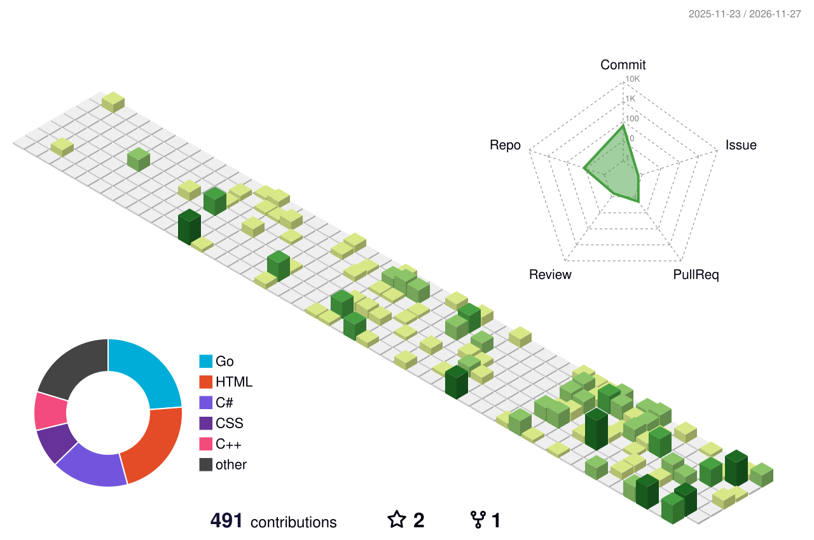

  

  

  
  
  
  

### 👨‍💻 About Me
- 💼 Working as a **freelance developer**, delivering end-to-end mobile apps and backend solutions.
- 📱 Building cross-platform experiences with **Flutter & Dart**, paired with **.NET**, **Laravel**, **Go**, **Python**, and **Firebase** backends.
- 🌐 Check out my portfolio at **[bashartaha06.github.io/Bashar__Taha](https://bashartaha06.github.io/Bashar__Taha/)**.

---

### 🛠 Languages, Frameworks & Tools

  <b>📱 Mobile & Frontend</b>  
  <picture>
    <source media="(prefers-color-scheme: dark)" srcset="https://skillicons.dev/icons?i=dart,flutter,react,ts&theme=dark" />
    <source media="(prefers-color-scheme: light)" srcset="https://skillicons.dev/icons?i=dart,flutter,react,ts&theme=light" />
    
  </picture>

  <b>⚙️ Backend, Systems & Tools</b>  
  <picture>
    <source media="(prefers-color-scheme: dark)" srcset="https://skillicons.dev/icons?i=dotnet,cs,laravel,go,py,cpp,firebase,git,github,vscode&theme=dark" />
    <source media="(prefers-color-scheme: light)" srcset="https://skillicons.dev/icons?i=dotnet,cs,laravel,go,py,cpp,firebase,git,github,vscode&theme=light" />
    
  </picture>

---

### 🚀 Featured Projects

  <a href="https://github.com/BasharTaha06/Agentic_Hotel_Assistant">
    <picture>
      <source media="(prefers-color-scheme: dark)" srcset="https://github-readme-stats.vercel.app/api/pin/?username=BasharTaha06&repo=Agentic_Hotel_Assistant&theme=dark&hide_border=true" />
      <source media="(prefers-color-scheme: light)" srcset="https://github-readme-stats.vercel.app/api/pin/?username=BasharTaha06&repo=Agentic_Hotel_Assistant&theme=default&hide_border=true" />
      
    </picture>
  </a>
  <a href="https://github.com/BasharTaha06/Hostel-Management-Backend-DotNet">
    <picture>
      <source media="(prefers-color-scheme: dark)" srcset="https://github-readme-stats.vercel.app/api/pin/?username=BasharTaha06&repo=Hostel-Management-Backend-DotNet&theme=dark&hide_border=true" />
      <source media="(prefers-color-scheme: light)" srcset="https://github-readme-stats.vercel.app/api/pin/?username=BasharTaha06&repo=Hostel-Management-Backend-DotNet&theme=default&hide_border=true" />
      
    </picture>
  </a>

  <a href="https://github.com/BasharTaha06/To-Do-app-with-flutter">
    <picture>
      <source media="(prefers-color-scheme: dark)" srcset="https://github-readme-stats.vercel.app/api/pin/?username=BasharTaha06&repo=To-Do-app-with-flutter&theme=dark&hide_border=true" />
      <source media="(prefers-color-scheme: light)" srcset="https://github-readme-stats.vercel.app/api/pin/?username=BasharTaha06&repo=To-Do-app-with-flutter&theme=default&hide_border=true" />
      
    </picture>
  </a>
  <a href="https://github.com/BasharTaha06/Bashar__Taha">
    <picture>
      <source media="(prefers-color-scheme: dark)" srcset="https://github-readme-stats.vercel.app/api/pin/?username=BasharTaha06&repo=Bashar__Taha&theme=dark&hide_border=true" />
      <source media="(prefers-color-scheme: light)" srcset="https://github-readme-stats.vercel.app/api/pin/?username=BasharTaha06&repo=Bashar__Taha&theme=default&hide_border=true" />
      
    </picture>
  </a>

---

### 📊 GitHub Stats, Trophies & Activity

  <picture>
    <source media="(prefers-color-scheme: dark)" srcset="https://github-readme-stats.vercel.app/api?username=BasharTaha06&show_icons=true&theme=dark&hide_border=true" />
    <source media="(prefers-color-scheme: light)" srcset="https://github-readme-stats.vercel.app/api?username=BasharTaha06&show_icons=true&theme=default&hide_border=true" />
    
  </picture>
  <picture>
    <source media="(prefers-color-scheme: dark)" srcset="https://github-readme-streak-stats.herokuapp.com/?user=BasharTaha06&theme=dark&hide_border=true" />
    <source media="(prefers-color-scheme: light)" srcset="https://github-readme-streak-stats.herokuapp.com/?user=BasharTaha06&theme=default&hide_border=true" />
    
  </picture>

  <picture>
    <source media="(prefers-color-scheme: dark)" srcset="https://github-readme-stats.vercel.app/api/top-langs/?username=BasharTaha06&layout=compact&theme=dark&hide_border=true" />
    <source media="(prefers-color-scheme: light)" srcset="https://github-readme-stats.vercel.app/api/top-langs/?username=BasharTaha06&layout=compact&theme=default&hide_border=true" />
    
  </picture>

  <picture>
    <source media="(prefers-color-scheme: dark)" srcset="https://trophy.ryglcloud.net/?username=BasharTaha06&theme=onedark&no-frame=true&no-bg=true&row=1&column=6" />
    <source media="(prefers-color-scheme: light)" srcset="https://trophy.ryglcloud.net/?username=BasharTaha06&theme=flat&no-frame=true&no-bg=true&row=1&column=6" />
    
  </picture>

  <picture>
    <source media="(prefers-color-scheme: dark)" srcset="https://github-readme-activity-graph.ashutosh-dwivedi0710.workers.dev/graph?username=BasharTaha06&theme=tokyo-night&hide_border=true" />
    <source media="(prefers-color-scheme: light)" srcset="https://github-readme-activity-graph.ashutosh-dwivedi0710.workers.dev/graph?username=BasharTaha06&theme=github-compact&hide_border=true" />
    
  </picture>

---

### 🎮 Contribution Animations

  <picture>
    <source media="(prefers-color-scheme: dark)" srcset="https://raw.githubusercontent.com/BasharTaha06/bashartaha06/output/github-contribution-grid-snake-dark.svg" />
    <source media="(prefers-color-scheme: light)" srcset="https://raw.githubusercontent.com/BasharTaha06/bashartaha06/output/github-contribution-grid-snake.svg" />
    
  </picture>

  <picture>
    <source media="(prefers-color-scheme: dark)" srcset="https://raw.githubusercontent.com/BasharTaha06/bashartaha06/output-pacman/pacman-contribution-graph-dark.svg" />
    <source media="(prefers-color-scheme: light)" srcset="https://raw.githubusercontent.com/BasharTaha06/bashartaha06/output-pacman/pacman-contribution-graph.svg" />
    
  </picture>

  <picture>
    <source media="(prefers-color-scheme: dark)" srcset="./profile-3d-contrib/profile-night-green.svg" />
    <source media="(prefers-color-scheme: light)" srcset="./profile-3d-contrib/profile-green-animate.svg" />
    
  </picture>

---

### 🤝 Connect with Me

  
  
  

  

